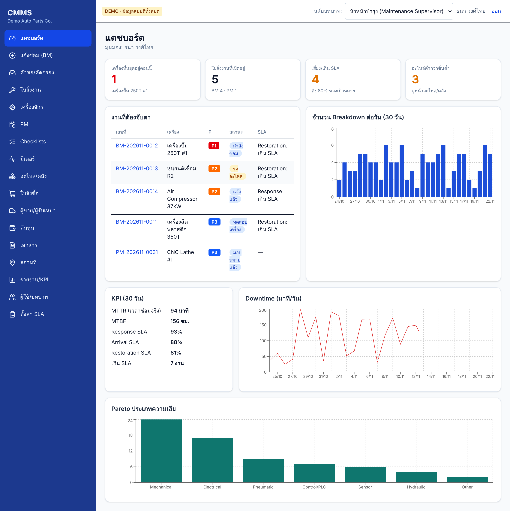
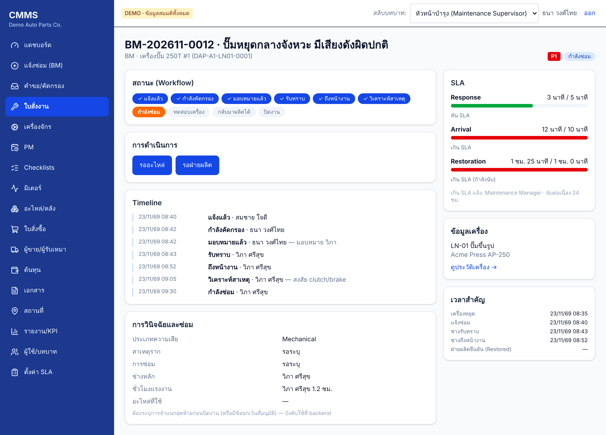
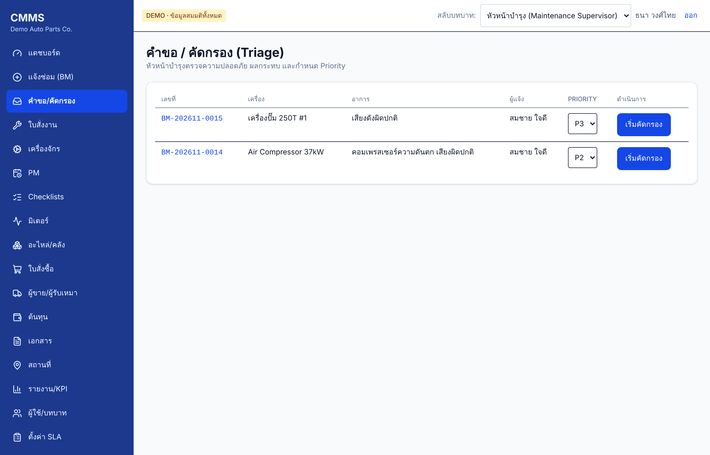
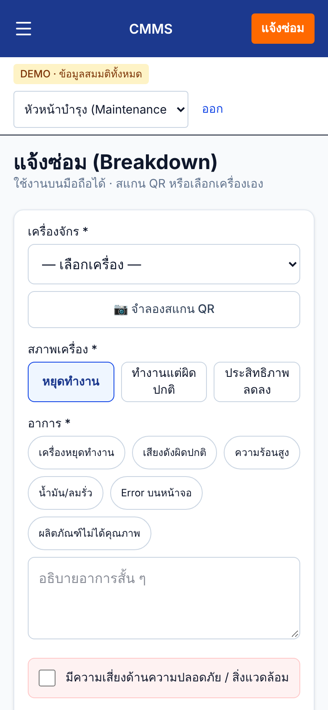

# CMMS — Breakdown Maintenance Portfolio Demo

A portfolio project: a Computerized Maintenance Management System (CMMS) built around a **Breakdown Maintenance (BM)** workflow with SLA tracking, downtime, triage and KPIs.

> **All data is fictional** ("Demo Auto Parts Co."). No real company, people, assets or figures. Feature scope was inspired by [Atlas CMMS](https://github.com/Grashjs/cmms) (AGPLv3); this project is a from-scratch rewrite and contains none of its code.

**Stack:** Next.js (App Router) · TypeScript · Tailwind · Recharts — planned backend: Go Fiber · PostgreSQL (GORM) · MinIO · Docker Compose.

## Status

| Phase | State |
|---|---|
| Frontend demo (mock data, swappable API layer) | ✅ this repo, `web/` |
| Go Fiber API + PostgreSQL (Release 1) | planned — see [docs/PLAN.md](docs/PLAN.md) and [docs/BACKEND_PLAN.md](docs/BACKEND_PLAN.md) |

## What the demo shows

- **BM workflow** with role-gated transitions: report → triage → assign → acknowledge → on site → diagnose → repair → test → *production confirms Restored* → supervisor approves close (reopen supported).
- **SLA engine** (Response / Arrival / Restoration) with 50 % / 80 % / breach states, escalation targets, and a mandatory breach reason before closing. Restoration runs from machine stop until production confirms, and keeps running during *Waiting for Parts/Production*.
- Mobile-first quick report form with QR simulation, symptom templates and a local draft (no offline submission).
- Dashboard per role, KPI page (MTTR, MTBF, SLA compliance, Pareto), assets with history, PM, checklists, meters, parts (low-stock alert), purchase orders, vendors, costs, files, locations, users, SLA settings.
- Role switcher in the header — walk the whole flow as operator → supervisor → technician → production supervisor.

## Run it

```bash
cd web
npm install
npm run dev          # http://localhost:3000
```

or with Docker:

```bash
docker compose up --build
```

Data lives in the browser (`localStorage`). The API layer (`web/src/lib/api.ts`) exposes a `CmmsApi` interface; set `NEXT_PUBLIC_API_MODE=http` once the Go API exists.

## Screenshots

| Dashboard | BM work order + SLA |
|---|---|
|  |  |
| Triage | Mobile report |
|  |  |

## Design notes

- Workflow transitions are a single table (`web/src/lib/workflow.ts`); the Go backend must enforce the same table, never a free-form status update.
- SLA rules live in one place (`web/src/lib/sla.ts`) and mirror the planned `maintenance_sla_configs` table, with versioning so changing a target never affects open work orders.
- Safety (LOTO/permits) is intentionally a placeholder: the app records, it never asserts a machine is safe.
